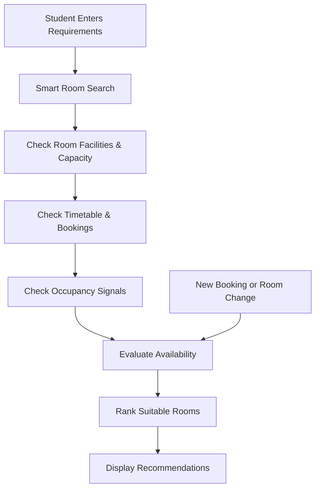
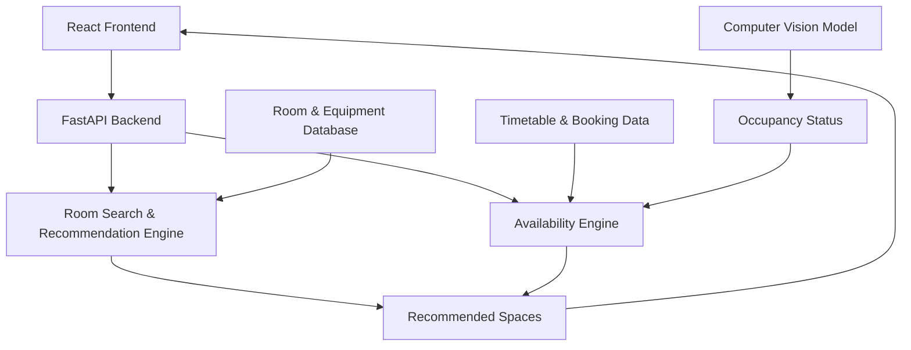

# 🔍 SpaceLens
### See Beyond the Timetable.

**An AI-Powered Real-Time Campus Space Discovery Platform**

SpaceLens helps university students find suitable classrooms, study spaces, auditoriums, and computer labs based on **real-time occupancy signals, timetable availability, room facilities, and their preferred time duration**.

Instead of spending time walking around campus searching for empty rooms, students can discover spaces that match their needs in one place.

**🏆 Hackathon Track:** Smart Campus & Student Experience  
**🚧 Status:** Prototype in Development

---

## 🎬 Demo & Pitch Deck

| Resource | Link |
|---|---|
| 🎥 Demo Video | [Coming Soon — Add Video Link] |
| 📊 Pitch Deck | [Coming Soon — Add Slides Link] |
| 🌐 Live Demo | [Coming Soon — Add Deployment Link] |

---

## 📌 1. The Problem

Finding an available classroom or study space on campus can be surprisingly frustrating.

Even with existing classroom finder applications, students may face:

- **Incomplete room listings** — Many usable classrooms and facilities are missing from the system.
- **Limited or inaccurate filters** — Difficult to find rooms with specific equipment, capacity, or facilities.
- **Unreliable availability information** — A room may appear free in the timetable but already be occupied.
- **Unexpected schedule changes** — Replacement classes, events, or room changes may not be reflected immediately.
- **Wasted time** — Students may spend significant time searching across multiple buildings, only to discover that a room is unsuitable or unavailable.

**The real challenge isn't just finding an empty room. It's finding the right room that is suitable and available for the entire time students need it.**

---

## 💡 2. Our Solution

**SpaceLens** is an intelligent campus space discovery system that combines multiple sources of information to recommend suitable spaces.

Students can search using:

- 📅 **Date & Time** — When they need the room and for how long.
- 👥 **Capacity** — Number of people.
- 📽️ **Facilities** — Projector, whiteboard, desktop computers, power sockets, etc.
- 🏫 **Space Type** — Classroom, auditorium, computer lab, or study area.
- 📍 **Location** — Preferred building or nearby spaces.

SpaceLens evaluates the requested requirements against available room information, timetable records, bookings, and occupancy observations.

### Example

A group of six students needs a room from **2:00 PM to 4:00 PM** with a projector and whiteboard.

SpaceLens aims to recommend rooms that:

1. Accommodate at least six people.
2. Have the required facilities.
3. Have no known scheduling conflicts during the requested period.
4. Have suitable occupancy and access information.
5. Are conveniently located.

A classroom that is empty at 2:00 PM but booked at 3:00 PM should **not** be recommended for the full two-hour session.

---

## ✨ 3. Key Features

### 🔎 Smart Room Discovery
Filter campus spaces by time, duration, capacity, equipment, location, and intended activity.

### 📅 Full-Duration Availability
Check whether a room is scheduled to remain available throughout the student's requested time, not just at the start.

### 👁️ AI-Powered Occupancy Detection
Use computer vision to estimate whether a room is physically occupied.

For the prototype, occupancy detection will be demonstrated using staged or consented video footage rather than direct access to university CCTV.

### ⚡ Dynamic Availability Updates
Update room recommendations when new bookings, events, classroom changes, or occupancy information become available.

### 🧠 Intelligent Recommendations
Rank suitable rooms based on facility requirements, availability information, capacity, and location.

### 🔄 Alternative Room Suggestions
Suggest another suitable room if a previously recommended space becomes unavailable.

> **Important:** Physical emptiness does not necessarily mean a room is permitted for student use. SpaceLens distinguishes observed occupancy from scheduled availability and access permission.

---

## ⚙️ 4. How It Works



**Step 1 — Search:** Students specify their required facilities, group size, date, and duration.

**Step 2 — Filter:** The system identifies rooms that meet mandatory requirements.

**Step 3 — Verify:** It checks scheduling conflicts, booking information, access permissions, and available occupancy signals.

**Step 4 — Recommend:** Suitable rooms are ranked and displayed with their availability status.

**Step 5 — Update:** When new information arrives, affected recommendations are re-evaluated.

### What Makes SpaceLens Different?

Unlike a basic classroom directory, SpaceLens is designed to combine **scheduled availability with physical occupancy observations**.

This allows it to distinguish between:

- A room that is scheduled free and observed empty.
- A room that is scheduled free but currently occupied.
- A room that appears empty but is reserved.
- A room with incomplete or outdated availability information.

The goal is to provide more trustworthy recommendations instead of assuming that an empty room is automatically available.

---

## 🛠️ 5. Tech Stack & Architecture

### Proposed Tech Stack

| Component | Technology |
|---|---|
| Frontend | React + TypeScript |
| Backend | Python + FastAPI |
| Database | PostgreSQL / Supabase |
| Computer Vision | YOLO / OpenCV |
| Recommendation Engine | Python-based filtering and ranking |
| Real-Time Updates | Supabase Realtime / WebSockets |
| Cloud Deployment | Google Cloud Run |

*Technologies may change during development.*

### System Architecture



---

## 🚀 6. Getting Started

**Project Status:** Under development.

Installation and setup instructions will be updated as the prototype is implemented.

### Prerequisites

Planned development requirements:

- Node.js
- Python 3.10+
- PostgreSQL or Supabase
- Git

### Clone the Repository

```bash
git clone https://github.com/YOUR_USERNAME/SpaceLens.git
cd SpaceLens
```

### Installation

Frontend and backend setup commands will be added once the project structure and dependencies are finalized.

### Running the Prototype

Development commands, environment variables, and deployment instructions will be documented here as implementation progresses.

---

## 🎯 7. Impact & Future Development

### Expected Impact

SpaceLens aims to:

- ⏱️ **Reduce time wasted** searching for suitable campus spaces.
- 🏫 **Improve campus space utilization** by making underused facilities easier to discover.
- 📚 **Support student productivity** by helping students find spaces for studying, discussions, presentations, and projects.
- 🔄 **Reduce unexpected room conflicts** through better availability information.
- 📊 **Support data-driven campus management** with aggregated room usage insights.

These are intended outcomes, not yet measured results. Prototype evaluation will focus on search completion time, recommendation accuracy, and successful full-duration matches.

### Future Enhancements

- Integration with official university timetable and booking systems.
- Authorized real-time occupancy sensors or CCTV integrations.
- Interactive campus maps and indoor navigation.
- Room reservation and approval workflows.
- Equipment fault reporting.
- Predictive space availability and demand analytics.
- Intelligent room allocation to improve campus resource utilization.

---

### 🔍 SpaceLens — See Beyond the Timetable.

*Find the right space. At the right time. For the right purpose.*
